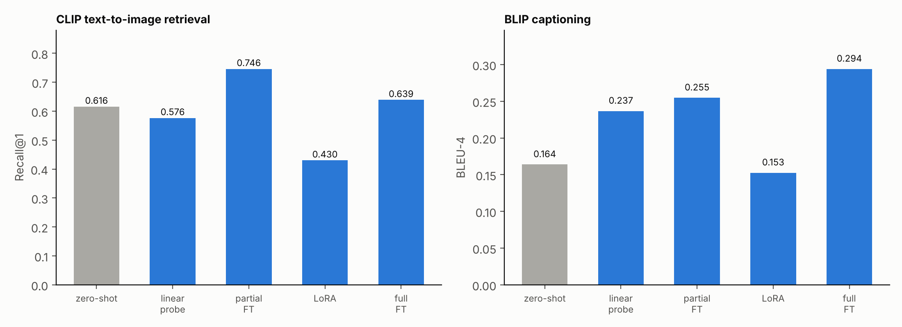
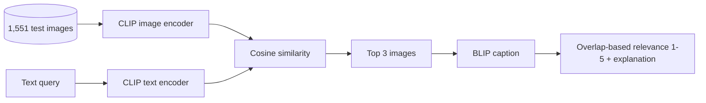

# CLIP and BLIP on Flickr30k: retrieval, captioning and four ways to adapt them

Coursework for DATA 266 at San José State University, Spring 2026 (Homework 4, multimodal learning). Zero-shot CLIP and BLIP baselines on Flickr30k, then four adaptation strategies for each (linear probe, partial fine-tuning, LoRA, full fine-tuning), and a small retrieve-then-caption pipeline.



## Setup

- Data: Flickr30k, 31,014 images with 5 captions each. Fixed image-level split (seed 42): 29,463 train, **1,551 test** images. Fine-tuning uses the first 10,000 training images, flattened to 50,000 (image, caption) pairs.
- Models: `openai/clip-vit-base-patch32` (151.3M parameters) and `Salesforce/blip-image-captioning-base`.
- Retrieval task: for each test image, its first caption is the query; the correct image must be ranked first among all 1,551 test images.
- Training: 3 epochs per method, one run each.

## Results

CLIP text-to-image retrieval, Recall@1 (1,551 queries):

| Method | Recall@1 | Trainable parameters |
|---|---|---|
| Zero-shot | **0.6157** (R@5 0.8459, MRR 0.7211) | none |
| Linear probe (projection layers) | 0.5764 | under 0.5% |
| Partial fine-tune (last 2 blocks of both encoders) | **0.7460** | about 20 to 25% |
| LoRA (text encoder only, r=16) | 0.4300 | about 0.5% |
| Full fine-tune | 0.6389 | 100% |

BLIP captioning, BLEU-4 against all 5 references:

| Method | BLEU-4 |
|---|---|
| Zero-shot | 0.1639 (ROUGE-L 0.2438, METEOR 0.1385, BERTScore F1 0.8924) |
| Linear probe (LM head) | 0.2368 |
| Partial fine-tune (last 2 decoder layers) | 0.2548 |
| LoRA (decoder q/v, r=16) | 0.1527 |
| Full fine-tune | **0.2941** (ROUGE-L 0.3455) |

What stands out: partial fine-tuning is the best way to adapt CLIP (+13 points of Recall@1 over zero-shot) and full fine-tuning is the best for BLIP. For CLIP, three of the four adaptations scored **below** the zero-shot model, so adapting CLIP is easy to get wrong.

## How to read these numbers

- **Source of the numbers.** Zero-shot CLIP and the BLIP baseline come from printed notebook output (the BLIP baseline row was re-typed into a later cell). The fine-tuned numbers above are the ones quoted in the notebook's own written analysis. The full per-method tables (Recall@5, MRR, BERTScore, METEOR for fine-tuned models) were printed in the notebook but not saved in a form I could recover, so they are not shown. All values are in [`results/metrics.csv`](results/metrics.csv) with their source.
- **One run per method**, no seeds varied, 1,551 test images. Differences of a point or two are within noise; the large gaps (partial FT versus zero-shot, LoRA versus everything) are not.
- **Why full fine-tuning lost to partial fine-tuning on CLIP is not established.** The notebook suggests overfitting at a low learning rate over 3 epochs, but I did not test it. Batch size (32 versus 64) and warmup also differ between the two runs.
- **Why CLIP-LoRA collapsed is a hypothesis, not a finding.** Only the text encoder was adapted while the vision encoder stayed frozen, which plausibly breaks the shared embedding space, but there was no ablation.
- **Part 4 ran on the full fine-tuned checkpoints**, even though partial fine-tuning had scored better for CLIP. The relevance score there is a word-overlap heuristic between query and generated caption (1 to 5), not a human judgement, and the written per-query commentary in the notebook is qualitative.
- Zero-shot BLIP sometimes produced degenerate captions such as "the sky is clear" for unrelated scenes; these were the three lowest-ROUGE examples. The notebook's labels for them (hallucination, generic, missing context) were assigned in code rather than inferred from the images.

## Pipeline



## Run it

```bash
pip install transformers datasets peft accelerate evaluate bert-score rouge-score nltk sacrebleu scikit-learn matplotlib tqdm
cd src
python baselines.py                 # zero-shot CLIP and BLIP
python finetune.py clip partial     # clip|blip  x  linear|partial|lora|full
python finetune.py blip full
python pipeline.py ckpt/clip_full ckpt/blip_full
python ../make_chart.py
```

The original runs used an A100 GPU in Colab.

## Files

| File | Purpose |
|---|---|
| `src/data.py` | Dataset loading, fixed split, 5-captions-per-image flattening |
| `src/evaluate_models.py` | Recall@K, MRR, BLEU, ROUGE-L, METEOR, BERTScore |
| `src/baselines.py` | Zero-shot CLIP and BLIP |
| `src/finetune.py` | Linear probe, partial, LoRA and full fine-tuning for both models |
| `src/pipeline.py` | CLIP retrieval, BLIP captioning, relevance heuristic |
| `results/metrics.csv` | Every reported number with its source |

The code was rebuilt from my course notebook (the three notebook copies differ slightly in dataset source and bug fixes).

Author: Vrushabh Bodarya

`PyTorch` `Transformers` `PEFT` `CLIP` `BLIP`
